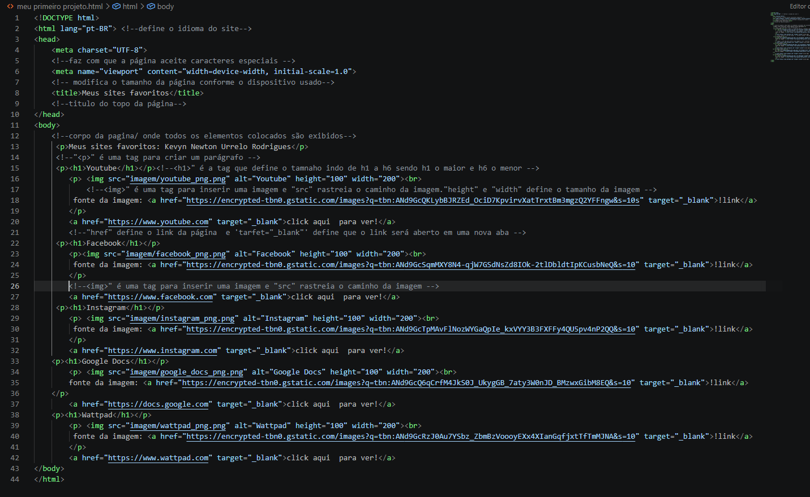
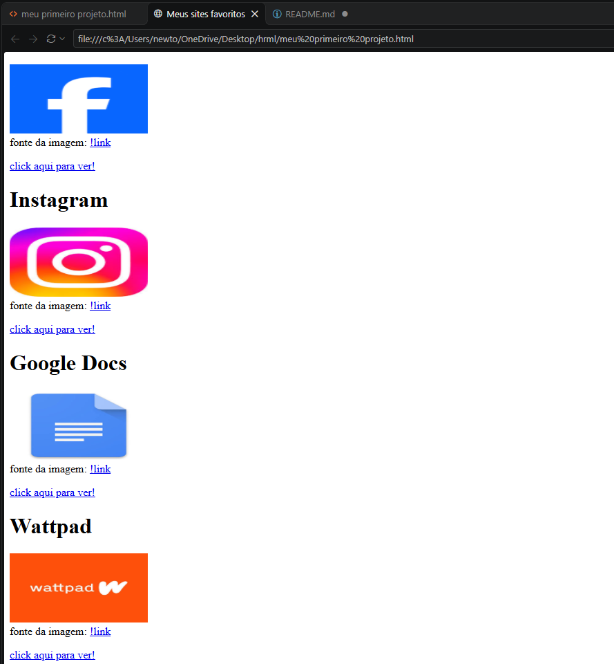

# projeto - meus sites favoritos em html

📝Esse projeto foi feito para o curso ETEC agenda 12 Desmvolvimento de Sistema 1. 
💻Esta atividade teve como objetivo demonstrar os conceitos de HTML abordados em aula por meio da criação de uma página web básica. O projeto apresenta uma seleção de sites favoritos, estruturados com nomes, imagens ilustrativas e links de acesso.

<strong>🤔como usar?</strong> 
Baixe o arquivo e abra em um navegador de sua preferencia. 
⚠️ nota - A página não esta ligada a um servidor, ela so abrirá se o arquivo estiver no computador.

 🛠️programas usados e estudados:

 
    
     

⚙️programa em execução.

